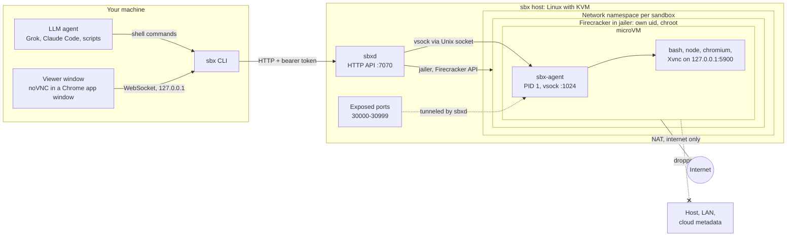
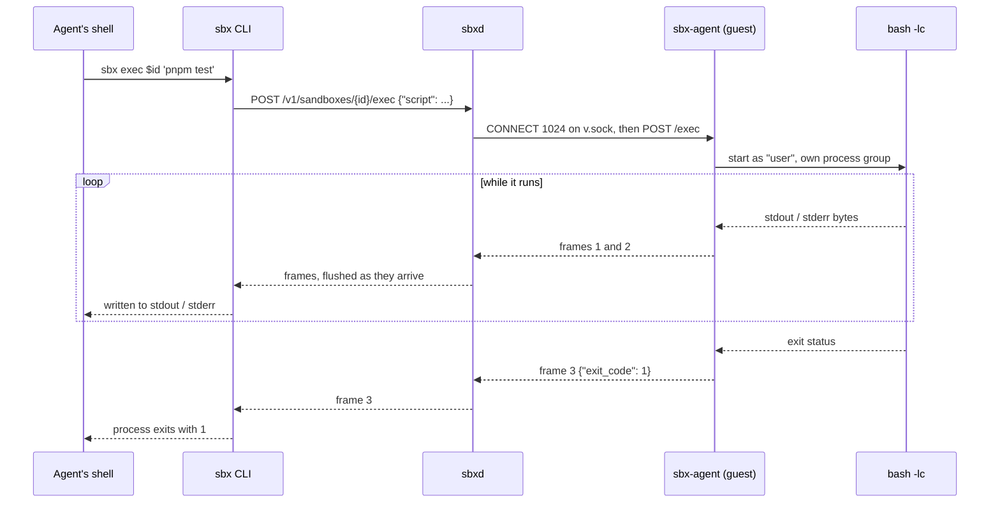
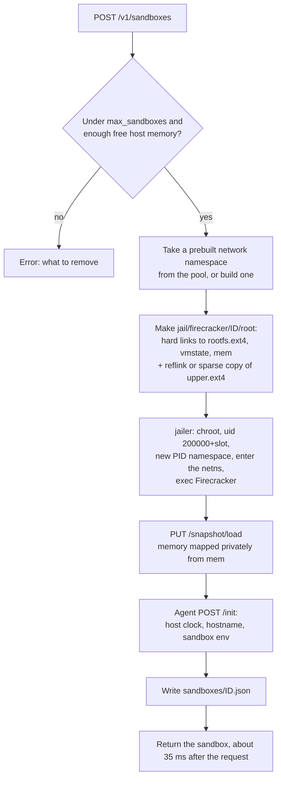
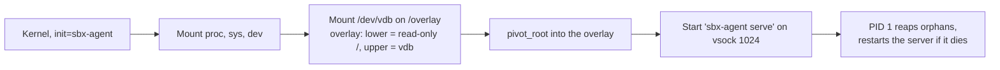
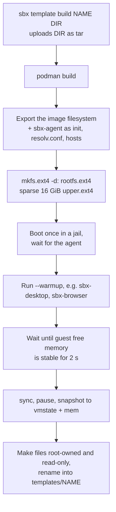
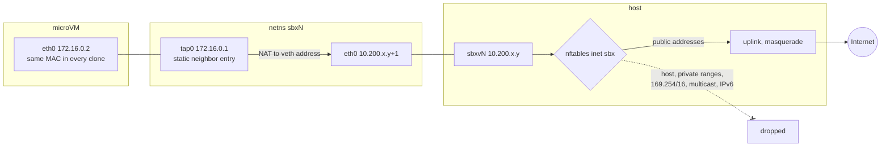
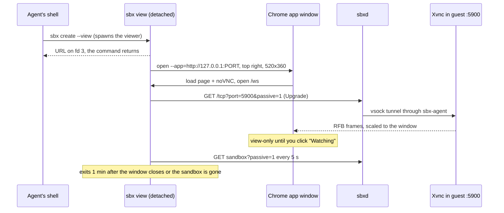
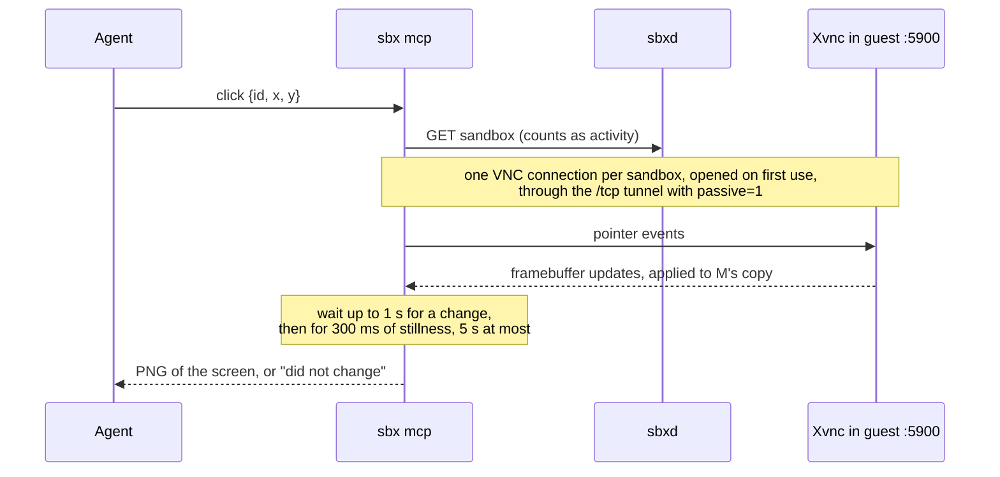
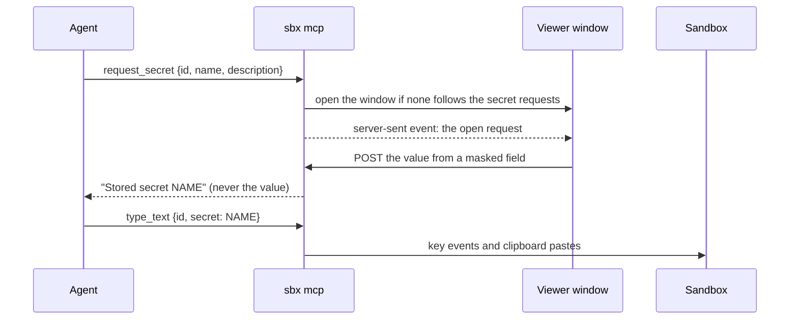
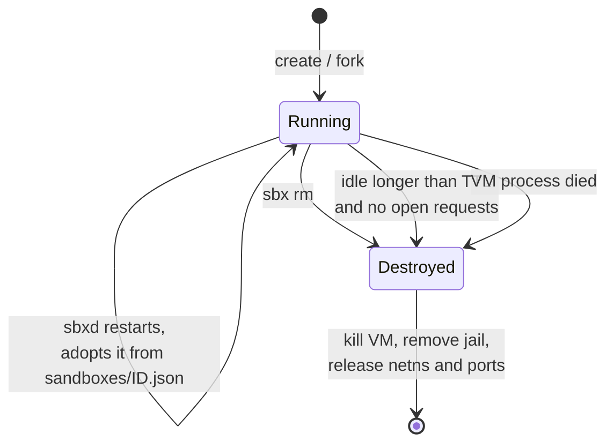

# sbx architecture

This document explains how sbx is built and why. [README.md](README.md) covers installing and using it.

sbx has three programs. They talk over two links: HTTP from the CLI to the daemon, and vsock from the daemon into each guest.

| Program | Runs | Job |
|---|---|---|
| `sbx` | where agents run | CLI for agents and people; also serves the screen viewer |
| `sbxd` | the sbx host, as root | Owns every sandbox: restores, networks, tunnels, expires, adopts |
| `sbx-agent` | inside every microVM, as PID 1 | Builds the root filesystem, then runs commands and moves bytes for sbxd |

`internal/proto` is the only package all three share: JSON types, the exec frame format, and the tar helpers.



## CLI design

The main users of `sbx` are LLM agents calling it from a shell, so the design follows what agents already handle well. They have read a lot of docker and coreutils, and they read help text and exit codes.

### Principles

1. **Familiar shapes.** Commands mirror docker: `exec -it`, `cp ID:path`, `rm`, `ls -q`, `-e NAME=VALUE`, `-w DIR`, `-d`. An agent guesses right more often than it reads docs.
2. **Output fits command substitution.** `create` and `fork` print only the new ID, so `id=$(sbx create)` works. Progress and notices go to stderr.
3. **Exit codes carry meaning.** `exec` and `run` exit with the command's own status. sbx's own failures exit 125, like docker. The agent also uses 124 (timed out), 127 (could not start), 137 (client disconnected), and 128+N (killed by signal N).
4. **One argument is a script, several are an argv.** `sbx exec $id 'cd app && make'` runs bash source. `sbx exec $id -- ls -la "my file"` quotes each word. Every command runs through `bash -lc`, so `PATH` and profile scripts match a login shell.
5. **Structured output on request.** Read commands take `--json`. Tables are for people.
6. **Errors say what to do next.** Not-found errors mention idle expiry and `sbx ls`; the limit error mentions `sbx rm`; a missing template points to `sbx template ls`.
7. **The help is the manual.** `sbx --help` opens with a workflow, and every command has examples. `skill/sbx/SKILL.md` condenses the same rules for agents that load skills.
8. **Nothing blocks by surprise.** `exec -d` returns a PID and log path. Background jobs (`cmd &`) do not hold `exec` open: output is cut 200 ms after the command exits. `view` detaches its server. Only `forward` stays in the foreground, by design.
9. **Cleanup is automatic.** Every sandbox has an idle TTL. `run` removes its sandbox even on Ctrl-C. A viewer exits on its own.

### Commands

| Group | Commands |
|---|---|
| Lifecycle | `create [TEMPLATE]`, `ls`, `inspect`, `rm`, `ttl`, `run` |
| Work | `exec`, `cp` |
| Reach inside | `expose`, `unexpose`, `forward`, `view` |
| Tools for agents | `mcp` |
| State | `snapshot`, `fork`, `template ls / build / rm` |
| Host | `status`, `login` |

### Configuration lookup

`sbx` takes the first value it finds:

1. `SBX_URL` and `SBX_TOKEN`, for agents in containers and CI
2. The file `sbx login` writes, in the user config directory (`~/Library/Application Support/sbx/` on macOS, `~/.config/sbx/` on Linux)
3. On the sbx host itself, `http://127.0.0.1:7070` and `/etc/sbx/token`

## How the parts talk

### HTTP API

sbxd serves a small REST API (listed in the README) behind a bearer token. Three kinds of answers exist:

- **JSON** for lifecycle calls.
- **A frame stream** for `exec` and template builds. Each frame is 1 type byte, a 4-byte big-endian length, and the payload. Types are stdout (1), stderr (2), exit (3), stdin (4), stdin EOF (5), and resize (6). The exit frame carries `{"exit_code", "error", "pid", "log"}`. Framing keeps stdout and stderr apart on one connection and puts the exit status in-band.
- **A protocol switch** (`101 Switching Protocols`) for interactive exec, TCP tunnels, and the screen. After the switch the connection is a raw byte pipe.

Requests on a sandbox count as activity unless they carry `passive=1`, which the viewer uses.

### Into the guest: vsock

Each Firecracker exposes the guest's vsock as a Unix socket in its jail (`v.sock`). sbxd writes `CONNECT 1024\n`, waits for `OK …\n`, then speaks plain HTTP/1.1 to `sbx-agent`. Every request opens a new connection; they cost microseconds, and a snapshot resets open ones anyway.

sbxd mostly proxies: it forwards the API request to the agent and copies the answer back. When the agent answers `101`, both connections become one pipe (`proto.Splice`), and that pipe carries interactive exec and every TCP tunnel.



If the client disconnects, sbxd closes the guest connection and the agent kills the command's whole process group. A `--timeout` does the same inside the guest.

## Creating a sandbox

A template is a directory under `/var/lib/sbx/templates/NAME` holding a snapshot of a booted guest. Creating a sandbox restores that snapshot; nothing boots.



The design choices behind each step:

- **Hard links and a chroot.** A snapshot records the file paths it was taken with. Each clone's jail holds links with the same names, so every clone sees `/rootfs.ext4`, `/mem`, and so on, while the files exist once on disk.
- **Private memory mapping.** Clones read the template's memory through the host page cache and copy only the pages they write. An idle sandbox costs about 5 MiB.
- **Read-only root, private upper disk.** `rootfs.ext4` is shared read-only by every clone. Each clone gets its own sparse `upper.ext4`, the upper layer of an overlay. Writes cost host disk instead of guest RAM.
- **Clock reset.** A restored guest wakes with the snapshot's time. `/init` sets the real time before any command runs.

### Inside the guest at boot

This happens once per template, when it is built. Clones start after it.



## Building a template



The settle step matters. Programs a warmup starts in the background keep loading after it returns, and every page they touch after the snapshot is copied into each clone. Snapshotting the desktop before it settled cost every sandbox 70 MiB.

`sbx snapshot` saves a running sandbox the same way: pause, snapshot memory, copy the upper disk (a reflink when the filesystem allows) while still paused, resume. `sbx fork` is a snapshot to a hidden template followed by a create from it.

## Network

All clones share one snapshot, so all have the same guest IP and MAC. Each one gets an identical private world:



- Namespaces are built ahead of time (8 by default), so a create never waits for `ip` and `nft`.
- The guest MAC and the neighbor entry stay fixed. In the lab, a changed MAC cost 30 s of lost traffic and a missing entry a 1 s ARP wait.
- Docker and ufw set the iptables FORWARD policy to DROP. sbxd adds accept rules for `sbxv+` there, because a packet must pass every chain on the hook. Its own table still drops private ranges.
- Nothing routes into a sandbox. Inbound traffic arrives through vsock:
  - `expose` binds a host port and tunnels each connection through the agent's `/tcp` upgrade.
  - `forward` and `view` do the same through the API from the client side.
  - The agent dials 127.0.0.1 first, so servers inside may listen on localhost.

## Screen viewer



- Every template runs `sbx-desktop` before its snapshot: Xvnc on display `:0`, VNC on the guest's loopback with no password, and openbox. Commands get `DISPLAY=:0`.
- noVNC is embedded in the `sbx` binary, so the viewer needs only a browser.
- Passive requests keep the viewer from extending the sandbox's idle TTL. A forgotten window cannot keep a sandbox alive.

## MCP server and computer use

`sbx mcp` serves the same operations as MCP tools, plus a desktop that agents operate like computer use. It runs where the agent runs, one process per agent session.



- **The screen is always current in the server.** The VNC client keeps an incremental update request outstanding, so Xvnc sends changed rectangles as they happen. A screenshot is a copy of memory, and every action knows whether and when the screen changed after it.
- **Activity.** The VNC tunnel is passive, or an open MCP server would keep every sandbox it touched alive forever. Each tool call makes one ordinary API request instead, which resets the idle timer.
- **Text input.** ASCII goes as key events; Xvnc picks keycodes and shift state. Other characters go through the VNC extended clipboard, which carries UTF-8: the server announces new clipboard text, presses shift+Insert, hands over the text when Xvnc asks for it, and waits until the screen shows it before the next announcement, because a new announcement cancels a paste still in progress. Afterwards it announces an empty clipboard.

### Secrets and dropped files

The MCP server also serves the viewer for each sandbox it touches, in its own process, because both features need that process's memory.



- Values live in a map in the server's memory, keyed by the agent's name, and die with the process. They leave it only as input to a sandbox.
- A dropped file is posted to the viewer server, wrapped in a one-entry tar, and sent to `PUT /files` at `~/Downloads/NAME`. The next tool result for that sandbox tells the agent the path.
- Every viewer URL holds a random token. Any page in the user's browser can reach a loopback port, and this server drives sandboxes and accepts secrets.

## Lifecycle and recovery



- sbxd checks every 5 s. A sandbox with an exec or tunnel open never counts as idle.
- Firecracker processes outlive sbxd (`KillMode=process`). On start, sbxd adopts every VM whose PID and start time match its saved state, re-binds its exposed ports, and removes jails and namespaces nobody claims.
- Destroy waits until the VM process is gone before releasing its namespace, because the tap stays busy until then.

## Security boundaries

| Layer | What it stops |
|---|---|
| KVM + Firecracker | Guest code reaching host memory or devices; Firecracker has a minimal device model |
| Jailer and seccomp | A VMM escape: Firecracker runs as its own uid, chrooted, in its own PID namespace, and filters its own syscalls |
| Network namespace + nftables | Guest traffic to the host, LAN, cloud metadata, and IPv6 |
| vsock-only ingress | Inbound connections to the guest, except through sbxd |
| API token | Anyone on the network driving sbxd |
| Token in the viewer URL | Other web pages on the user's machine driving a sandbox or answering a secret prompt |
| Optional outer VM | A full host escape reaching the LAN, as in `deploy/proxmox` |

The agent inside the guest is unauthenticated. Only the host can reach its vsock port, and a sandbox owns its own guest anyway.

## Files on the host

```
/etc/sbx/sbxd.json, token          config and API token
/usr/local/bin/sbxd, sbx           binaries
/usr/local/lib/sbx/sbx-agent       copied into every template
/var/lib/sbx/kernel/vmlinux        guest kernel
/var/lib/sbx/templates/NAME/       rootfs.ext4, upper.ext4, vmstate, mem, template.json
/var/lib/sbx/jail/firecracker/ID/  per-sandbox jail and console.log
/var/lib/sbx/sandboxes/ID.json     state for adoption after a restart
/var/lib/sbx/build/                template build scratch
```
